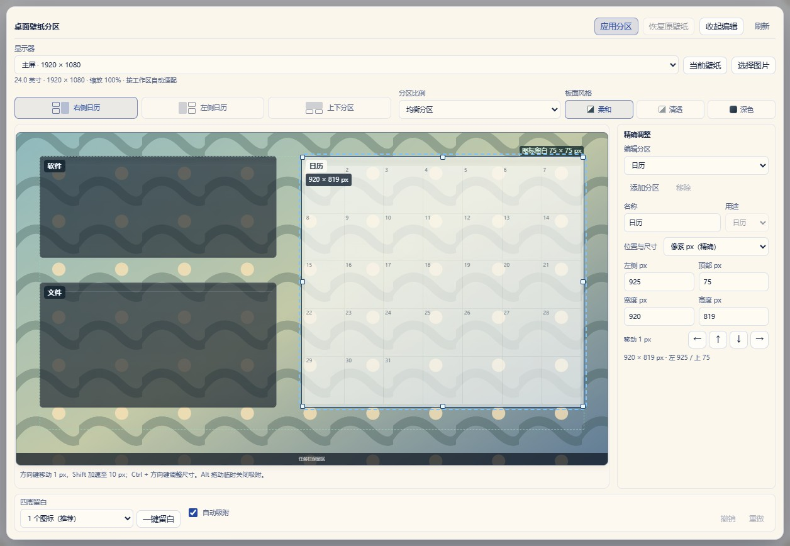
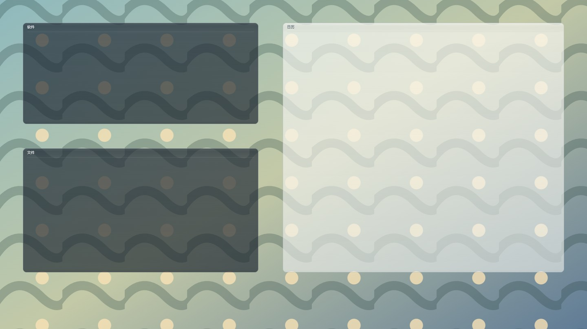

<div align="center">


# 日历清单 · Calendar List

让日历、待办和壁纸自然融入 Windows 桌面。

[](https://github.com/yq04/Calendar-List/releases/tag/v0.1.3)
[](https://github.com/yq04/Calendar-List/releases)
[](https://github.com/yq04/Calendar-List/releases/download/v0.1.3/CalendarList_0.1.3_x64-setup.exe)
[](LICENSE)

[**下载 v0.1.3 安装包**](https://github.com/yq04/Calendar-List/releases/download/v0.1.3/CalendarList_0.1.3_x64-setup.exe) · [发行说明](docs/RELEASE_NOTES_0.1.3.md) · [壁纸分区使用指南](docs/desktop-wallpaper-zones.md)

</div>

日历清单是一款使用 Rust、Tauri v2 和 WebView2 构建的 Windows 桌面日历与待办软件。默认只展示月历，双击日期即可记录安排；需要时再开启右侧详情栏。你可以使用普通窗口，也可以将日历固定到桌面，并为壁纸划分日历、软件和文件区域。

## v0.1.3 的变化

- **壁纸分区**：右侧日历、左侧日历和上下分区，配合均衡、疏朗、紧凑三种比例；默认在四周预留一格图标空间，也保留适当的壁纸景物。
- **精确且容易调整**：拖动吸附、对齐参考线、八方向缩放、像素输入和放大编辑；方向键移动 1px，Shift 加速到 10px，Ctrl + 方向键调整尺寸，Alt 拖动临时关闭吸附。
- **更协调的外观**：柔和、清透、深色板面配方，细边框与渐变底板；「高级微调」的字体和展开图标与其他设置统一。
- **按目标屏适配**：根据工作区、Windows 缩放和图标间距计算布局，显示可信的物理英寸信息；小空间自动采用紧凑布局，不按“24 寸”或“27 寸”硬编码分辨率。

已有自定义布局不会被升级自动重排。打开「设置 → 背景画布 → 桌面壁纸分区」，选择布局或点击「一键留白」即可预览新的比例。点击「应用分区」才会更改所选显示器的壁纸。

## 界面预览

以下图片来自 v0.1.3 的隔离浏览器演示，使用 Mock 数据与合成壁纸，不包含用户日历或真实桌面内容。编辑器中的日历网格是布局示意；实际日历是独立运行、可以编辑的窗口，不会被画进静态壁纸。

**常用布局与板面设置**


**放大编辑与像素精调**



**壁纸底板输出示意**



## 日常使用

- **直接记事**：双击日期格新建，双击已有事项修改；事项自然换行，空间不足时在格内滚动。月份按需要显示 35 或 42 格，右侧详情栏默认隐藏。
- **管理安排**：支持完成标记、跨日期拖动、搜索，以及日程编辑的撤销和重做。可使用中文日期与时间速记。
- **桌面常驻**：支持普通窗口、桌面固定、系统托盘、透明度调整和开机自启。可选的全局快捷键为 `Win + Alt + C`，默认关闭。
- **个性化**：内置主题、窗口质感、字体和背景选项；外观草稿可预览、保存或恢复。切换主题保留字体与布局，分区应用和主题保存分别生效。
- **本土日历**：提供农历、节气、节假日角标与自定义节假日数据入口。
- **导入导出**：支持只读导入外部日历数据库，以及 Markdown、PDF 和 [iCalendar 有限子集](docs/calendar-interoperability.md)。PDF 导出使用系统 Microsoft Edge。

## 壁纸分区的范围

分区支持静态壁纸和逐显示器应用，生成独立图片副本并保留恢复记录。软件与文件区是视觉区域，图标由用户手动拖入，程序不会自动分类、搬移桌面文件。关闭程序后，静态分区底板仍保留；显示和编辑日历需要程序运行。

跨屏 Span、系统壁纸幻灯片和动态壁纸目前不支持。若壁纸已被 Windows 或其他软件更换，恢复操作会提示并保留新壁纸，避免覆盖。硬件未报告可靠的物理尺寸时，使用工作区和 DPI 适配，不推测英寸。

24/27 寸、1080p/1440p、4K、多种缩放及竖屏参数已做合成布局检查；这不等于所有实体设备均已验收。真实系统壁纸应用、混合 DPI 热插拔及不同任务栏位置仍需更多实机反馈。使用较低底板强度时，文字可读性也会受到壁纸本身影响。

## 下载与安装

- 系统：Windows 10 / 11，x64，需要 Microsoft Edge WebView2 Runtime。
- 安装包：[CalendarList_0.1.3_x64-setup.exe](https://github.com/yq04/Calendar-List/releases/download/v0.1.3/CalendarList_0.1.3_x64-setup.exe)。
- 大小：**2,500,636 字节（约 2.38 MiB）**。这是安装器体积，不代表运行时内存或 WebView2 Runtime 的大小。
- SHA-256：`0AB11A82FBC387249E570B842854580DD79A92B53F73849E03EDDCF5C9185EFC`。

运行安装器并选择安装目录。升级前请从系统托盘正常退出日历清单，并备份数据；选择原安装目录即可保留现有数据。不要先卸载并选择删除用户数据。本机已验证覆盖更新、程序版本和更新前后的数据文件哈希，其他安装路径与旧版本组合仍需继续验收。

默认可写安装目录的数据保存在 `<安装目录>/data/`，日历数据库为 `data/sandbox/kal_sandbox.db`；开发构建或安装目录不可写时会使用 `%APPDATA%/Kal/`。设置、主题、字体、备份及壁纸恢复副本同属应用数据，请将整个数据目录一并备份。外部 CalendarTask/DesktopCal 数据库仅作为只读来源，不直接写入。

安装包未内置 WebView2 浏览器内核；系统缺少 Runtime 时需要安装它。常驻资源开销包含主程序和 WebView2 子进程，不能仅按主程序内存判断整体占用。

## 开发与验证

技术栈为 Rust + Tauri v2、SQLite、原生 JavaScript ES Modules 和 CSS，无需前端打包器。源码中的 `src-tauri/` 负责 Windows 集成与存储，`ui/` 负责界面，`tools/` 提供开发检查工具。

Windows 构建需要 Rust stable 的 MSVC 工具链、Visual Studio C++ 构建工具、Windows SDK、Tauri CLI v2 和 WebView2。Node.js 用于运行前端检查，不是已安装程序的运行依赖。依赖版本以 `src-tauri/Cargo.lock` 为准。

```powershell
git clone https://github.com/yq04/Calendar-List.git
cd Calendar-List

# 分区几何模型检查
node ui/_desktop-zones-selftest.mjs

# 前后端配置与窗口定位合同检查
cargo test --manifest-path src-tauri/Cargo.toml desktop_zones_frontend_compositions_match_native_window_geometry --lib

# 打包 Windows x64 NSIS 安装器
cd src-tauri
cargo tauri build --bundles nsis
```

本版分区专项验证包括 20 组模型检查（135 个合成参数组合）、22 个浏览器关键检查，以及 Rust 前后端几何合同检查。发布前另通过 9 项 Rust 分区校验与隔离事务检查、8 项版本页检查。验证区分模拟页面、合成数据和原生只读探针，不将它们替代为真实桌面场景。运行其他存储或桌面测试前，应先检查脚本的隔离设置及清理行为，使用独立测试数据目录。

应用内「查看版本」展示实际运行的本机版本；请以 [GitHub Releases](https://github.com/yq04/Calendar-List/releases) 为下载来源，尚无在线版本比较或自动安装更新流程。

## 开源与反馈

源码使用 [MIT License](LICENSE)。主题配色的来源与许可见 [主题说明](docs/third-party-themes.md)；分区实现参考见 [壁纸分区文档](docs/desktop-wallpaper-zones.md#开源参考)。项目未包含原软件的程序或私有素材。

遇到显示或分区问题，可在 [Issues](https://github.com/yq04/Calendar-List/issues) 提供 Windows 版本、分辨率、缩放比例、显示器方向和复现步骤。截图中请先隐藏私人日程与文件名。
