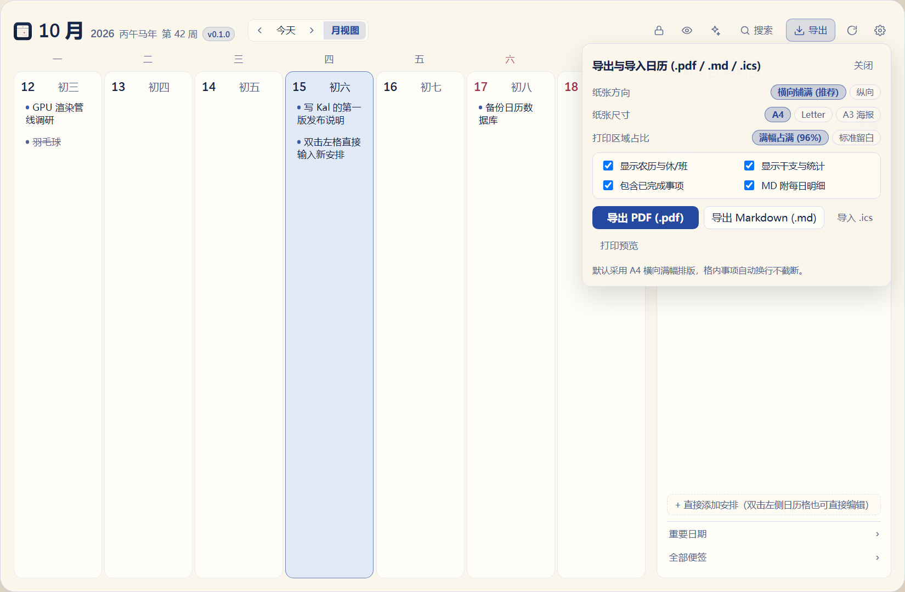
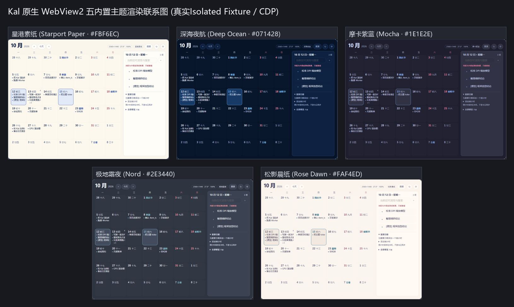

<div align="center">


# 日历清单 · Calendar List (`Kal`)

**轻量、温润、像壁纸一样自然融入桌面的 Windows 嵌入式日历与待办清单**  
*A Lightweight, Wallpaper-Fused Desktop Calendar & Todo List for Windows — Powered by Rust + Tauri v2*

[](https://github.com/yq04/Calendar-List/releases/tag/v0.1.1)
[](https://github.com/yq04/Calendar-List/releases)
[](https://github.com/yq04/Calendar-List/releases/download/v0.1.1/CalendarList_0.1.1_x64-setup.exe)
[](src-tauri/Cargo.toml)
[](ui/src/main.js)
[](tools/ui-check.mjs)
[](LICENSE)

[**⬇️ 下载 Windows x64 安装包 (v0.1.1 · 2.27 MB)**](https://github.com/yq04/Calendar-List/releases/download/v0.1.1/CalendarList_0.1.1_x64-setup.exe) · [**📋 v0.1.1 发行说明**](docs/RELEASE_NOTES_0.1.1.md) · [**🎨 主题与色板说明**](docs/theme-presets.md) · [**⚡ 性能基线报告**](docs/performance-baseline.md)

</div>

---

## ✨ 为什么选择「日历清单 · Calendar List」？

传统桌面日历（如 DesktopCal）拥有直觉化的月历格子记事模型，但其早期的 GDI 自绘渲染层难以兼顾现代 2K/4K 高分屏字体抗锯齿、多屏异构 DPI 与流畅交互；而重型全功能日历客户端又充斥着繁琐的弹窗表单、强制精确到分钟的时间段和沉重的后台内存占用。

**日历清单 · Calendar List (`Kal`)** 采用 **Rust + Tauri v2 + 零打包器原生 ES Module** 重新打造了一款既能当独立效率工作台、又能像壁纸一样静默常驻桌面的现代日历清单：

- 🪶 **2.25 MB 极致轻量，核显与办公本零负担**：纯 Rust 原生外壳 + 零构建依赖 ES Module 前端，无 Node.js 运行时与前端框架包体膨胀；内置「减少动画」与「温润实底」零模糊模式，老旧轻薄本也能丝滑常驻。
- 🖼️ **壁纸式常驻融合 & 一键透明底还原**：支持 `0% ~ 100%` **常驻壁纸融合透明度**（可自由设置 `全透 0% / 轻透 35% / 半透 65% / 微透 85% / 实底 100%`），固定在桌面上时**保持恒定透明度，不会因鼠标移出而忽明忽暗**；顶栏「透明底 / 还原实底」按钮与设置面板全分区均支持一键无损回到初始默认状态。
- 🖥️ **多显示器 / 横竖屏 / 24" & 27" 物理 PPI 自适应**：基于 Win32 `EnumDisplayMonitors` 与 GDI 物理毫米尺寸检测，精准识别单屏/双屏/多屏、**横屏（Landscape）与竖屏（Portrait 旋转副屏）**、不同分辨率与 DPI 缩放；内置 **8 种桌面固定预设**（含专为竖屏副屏设计的「占据屏幕上半区 / 下半区」），窗口跨越屏幕边缘时自动重算 PPI 字号比例。
- ✍️ **左右双侧原位直编 + 中文自然语言速记**：在**左侧 42 格日历任意格子双击直接打字**，或在**右侧每日清单原位新建/双击修改**；默认不强制填写时间，同时支持输入 `明天下午3点半 项目评审 !1 #核心` 自动解析日期、时刻、优先级与标签。
- 🎨 **护眼素纸美学 + OKLab 壁纸智能取色**：默认搭载「星港素纸」暖白护眼主题，内置 **5 套高对比度主题**、**6 套窗口质感配方**、**6 套精选字体与本地私有字体搜索导入**，并可通过 **OKLab 加权 k-means + 二分对比度求解** 从桌面壁纸实时生成符合 WCAG AA/AAA 标准的专属配色。
- 🗓️ **本土化日历与开放格式导出**：内置 1900–2100 农历、干支纪年、二十四节气、法定节假日「休/班」角标（兼容 `holiday-cn` 自定义 JSON）、可开关的传统黄历宜忌、单日 8 色底色标记，以及 **A4 横向满幅矢量 PDF / Markdown (`.md`) / 标准 iCalendar (`.ics`)** 双向导入导出。

---

## 🖼️ 界面预览（`v0.1.0` 实机渲染）

> 以下截图均来自 `v0.1.0` 真实前端渲染与隔离演示数据，不包含任何个人隐私信息。

### 1. 主界面总览（星港素纸护眼主题 · 精准周次与农历节气 · 满格 `+N 更多` 底栏常驻）
顶部集成 `[ ‹ 今天 › | 周视图 ]` 导航与快捷工具栏（`固定` / `防窥` / `透明底` / `搜索` / `导出` / `设置` 及窗口最小化与托盘隐藏控制），左侧 42 格等高矩阵清晰呈现公历、农历、节气与法定休/班角标；右侧聚焦当日待办清单、重要日期倒计时与跨日期便签本。


### 2. 左右双侧直接编辑（左侧日历格双击直编 + 右侧列表原位直编）
无论是习惯在**左侧日历格子上直接双击记录**（或点击格子右上角悬停 `+` 号），还是习惯在**右侧面板顶部/底部直接输入**，都能一键回车即存；双击任意已有事项即可原位修改文字，配合 `Ctrl+Z` / `Ctrl+Y` 多步撤销重做。

| 左侧日历格双击原位输入 | 右侧清单底部 `+ 添加安排` 原位编辑 |
| :---: | :---: |
|  |  |

### 3. 双栏设置中心 `v0.1.0`（桌面固定与多屏适配 · 壁纸常驻透明度 · 主题质感 · 字体搜索 · 操作日志）
左侧 6 大按需分类导航（`桌面与自启` / `预设主题` / `排版与字体` / `背景画布` / `高级微调` / `日志与版本`），每个分区与参数分组均配备独立的 **「恢复默认」** 按钮，再次点击任意已激活卡片即可一键还原默认状态。


<details>
<summary><b>🔍 点击展开更多预览：周视图 7 列专注看板、A4 横向满幅打印导出与 5 套内置主题对比</b></summary>
<br />

**周视图 7 列专注看板 & A4 横向满幅 PDF / Markdown / ICS 导出**：



**5 套内置高对比度主题（星港素纸 / 深海夜航 / 摩卡夜读 / 极北霜蓝 / 晨纸微光）**：



</details>

---

## 🚀 核心功能全景对比

| 模块 | 核心能力与交互细节 |
|---|---|
| **桌面固定与壁纸融合** | 一键嵌入 Windows 桌面图标层之下（`Progman` / `WorkerW`）；支持 **常驻壁纸透明度（0%~100% 5 档快选 + 无级滑杆）**，固定后不随鼠标移出变淡；支持 `Shift + 点击固定` 开启鼠标穿透 |
| **多屏与横竖屏自适应** | 自动枚举所有显示器并标注 `[主屏]`、`[横屏]`/`[竖屏]`、分辨率、物理英寸（如 `24.0"` / `27.0"`）与 DPI 缩放比；提供左半区、左侧避让图标、右半区、居中、**竖屏上半区、竖屏下半区**及原地锁定 8 种位置预设 |
| **日历矩阵与周视图** | 42 格月历矩阵、7 列纵向周视图专注看板（按 `W` 切换）、今日胶囊高亮、实时精准 ISO 周次徽章、年月快速跳转面板、可选日格事项条数角标 |
| **农历、节气与黄历** | 1900–2100 农历日期、干支纪年、二十四节气、数九与三伏、法定节假日「休/班」角标、支持在右侧「节假日配置」粘贴 `holiday-cn` JSON、支持在高级微调中按需开启传统黄历宜忌 |
| **双侧直编与 NLP 速记** | 左格双击新建、左格双击事项改字、右侧顶部快速输入、右侧底部 `+ 添加安排`；默认无时间负担，支持中文自然语言解析（日期/时间/跨天/`!1` 优先级/`#标签`）及单日 **8 色底色高亮标记** |
| **效率流转与生产力** | 跨日期格拖拽改期（`6px` 防误触阈值）、`Alt + 点击` 日格事项快速勾选完成、当日未完事项一键顺延（`+1天` / `Shift` 顺延下周）、多步撤销重做（`Ctrl+Z` / `Ctrl+Y`）、重要日期倒计时、跨日期便签本 CRUD |
| **主题、质感与字体** | 5 套内置主题、6 套窗口质感（温润实底 / 全透悬浮 / 冰晶毛玻璃 / 轻透壁纸 / 深邃暗晶 / 画布艺境）、4 套排版模板、6 套精选字体模板、系统字体与本地私有字体（`.ttf/.otf/.woff2`）同页搜索与导入 |
| **多格式导出与打印** | **A4 / A3 / Letter 横向或纵向满幅矢量 PDF**（格内自动换行零截断）、7 列 GFM **Markdown (`.md`)** 归档导出、RFC 5545 标准 **iCalendar (`.ics`)** 导入与导出 |

---

## ⌨️ 快捷键速查表

| 快捷键 | 功能说明 |
|---|---|
| `双击日历格空白处` / `Enter` | 在当前日历格内直接打开内联新建输入框（回车连续新建，`Esc` 关闭） |
| `双击已有事项` / `F2` | 在左侧日历格或右侧清单中原位修改事项文字 |
| `Alt + 点击日格事项` | 在左侧月历格内直接切换事项的完成/未完成状态 |
| `拖拽日格事项` | 将事项直接跨日期格拖拽移动到目标日期 |
| `T` | 立即回到今天并选中今日日期格 |
| `W` | 一键切换「月视图（42 格）」与「周视图（7 列看板）」 |
| `←` / `→` 或 `PageUp` / `PageDown` | 切换上个月 / 下个月（周视图下切换上一周 / 下一周） |
| `Shift + ← / →`、`↑ / ↓` | 按天（左右）或按周（上下 7 天）在日历格间移动焦点 |
| `Ctrl + F` | 打开全局日程搜索面板（支持按「全部 / 未完成 / 已完成」筛选并一键跳转） |
| `Ctrl + Z` / `Ctrl + Y` | 撤销 / 重做最近一步日程修改（编辑、完成切换、删除、跨日移动等） |
| `Shift + 点击「固定」` | 在桌面固定状态下切换「鼠标穿透」模式（也可通过系统托盘恢复交互） |
| `Alt + Space` / `Win + Alt + C` | 全局唤醒或显示/隐藏日历清单窗口（可在设置中按需开启） |

---

## 📦 下载与安装

前往 [**GitHub Releases (`v0.1.1`)**](https://github.com/yq04/Calendar-List/releases/tag/v0.1.1) 下载最新 Windows x64 安装包：

- **安装包文件**：[`CalendarList_0.1.1_x64-setup.exe`](https://github.com/yq04/Calendar-List/releases/download/v0.1.1/CalendarList_0.1.1_x64-setup.exe)
- **安装包大小**：`2,382,925` 字节（约 `2.27 MB`）
- **SHA-256 校验值**：`74343e78d8b377801b47d7bbda2dcd3b07000d164baaacae96279e7b846ae907`
- **系统要求**：Windows 10 / Windows 11 (x64)，内置 WebView2 Runtime（Windows 11 及现代 Windows 10 已默认自带）。
- **覆盖升级与就地数据继承**：双击安装包点击「下一步」即可直接覆盖升级，默认自动保留并继承全部日程、设置、主题与日志（存储于安装目录下的 `data/` 文件夹，不占用 C 盘）；或通过 PowerShell 指定安装目录（例如部署至 `D:\1_app\CalendarList`）：
  ```powershell
  Start-Process -FilePath .\CalendarList_0.1.1_x64-setup.exe -ArgumentList "/S /D=D:\1_app\CalendarList" -Wait
  ```

---

## 🛠️ 技术架构与目录结构

| 层级 | 技术选型 | 设计亮点 |
|---|---|---|
| **原生外壳** | Rust + Tauri v2 + `windows-sys` | 负责桌面图层嵌入（`Progman`/`WorkerW`）、多显示器横竖屏工作区对齐、系统托盘、GDI 物理显示器 PPI 感知、单实例锁与原子文件事务 |
| **渲染引擎** | WebView2 (Chromium DirectWrite) | 硬件加速字体抗锯齿、CSS 变量单一出口实时换肤、全透明底多层自适应护航字影、打印级 A4 横向矢量 PDF 导出 |
| **前端架构** | 原生 ES Module + 原生 CSS | **零 npm 依赖、零打包器**，14 个高内聚 ES 模块，单向数据流 + 异步序号守卫（`createSeqGuard`）杜绝竞态回显 |
| **数据存储** | `rusqlite` (bundled SQLite) | 开箱即用的独立沙盒数据库（`%APPDATA%\Kal\standalone_calendar.db`），同时兼容只读导入或 MCP 管道桥接外部 DesktopCal 数据库 |
| **色彩科学** | `image` + 自研 OKLab k-means | 在感知均匀的 OKLab 空间聚类壁纸主色，二分求解满足 WCAG AA/AAA 对比度的正文与强调色 |

```text
Calendar-List/
├── src-tauri/                 # Rust + Tauri v2 原生后端
│   ├── src/
│   │   ├── color.rs           # sRGB <-> OKLab 转换、WCAG 对比度计算与二分校正
│   │   ├── palette.rs         # 壁纸降采样与 OKLab 加权 k-means++ 聚类取色
│   │   ├── theme.rs           # 主题 Schema 校验、5 套内置预设与硬链接原子事务提交
│   │   ├── display.rs         # 多显示器枚举、横竖屏方向识别、物理毫米尺寸与真实 PPI 缩放
│   │   ├── embed.rs           # Windows 桌面层嵌入 (Progman/WorkerW) 与横竖屏自适应贴靠算法
│   │   ├── db.rs              # SQLite 日历范围查询 (range_events) 与日期归一化
│   │   ├── editing.rs         # 独立沙盒 CRUD、跨日改期、便签管理与快照乐观锁
│   │   ├── fonts.rs           # 系统字体枚举与私有字体目录安全加载
│   │   └── lib.rs             # Tauri IPC 命令路由、任务栏/托盘控制、开机自启与单实例唤醒
│   ├── themes/                # 5 套内置静态主题 JSON
│   └── tauri.conf.json        # Tauri v2 窗口与 NSIS 打包配置
├── ui/                        # 零构建依赖原生 ES Module 前端
│   ├── index.html             # 主视图、快捷顶栏、导出弹层与设置工作台骨架
│   ├── styles/                # tokens.css / layout.css / components.css / panel.css
│   ├── src/                   # main.js / calendar.js / lunar.js / nlp-parser.js / theme.js / panel.js 等
│   └── _selftest.mjs          # 132 项前端纯函数与状态机单元测试
├── tools/                     # 自动化实机验证与性能基线工具链
│   ├── ui-check.mjs           # 无头 Edge CDP 真实 DOM 端到端回归测试 (42 项全绿)
│   ├── perf-check.mjs         # 20 / 2k / 20k 规模性能评测探针
│   └── cdp.mjs                # 实时 WebView2 CDP 调试器
└── docs/                      # 发行说明、主题许可、性能基线与界面截图
```

---

## 💻 从源码构建与自动化验证

### 1. 环境准备
- **Rust 工具链**：Rust 1.77+ (`stable-x86_64-pc-windows-msvc`)
- **Tauri CLI**：`cargo install tauri-cli --version "^2.0.0"`
- **Node.js 20+**（仅用于运行 `ui/_selftest.mjs` 与 `tools/ui-check.mjs` 自动化测试，前端本身无需 `npm install`）

### 2. 开发运行与打包安装器

```powershell
# 克隆仓库
git clone https://github.com/yq04/Calendar-List.git
cd Calendar-List

# 开发模式启动
cargo run --manifest-path src-tauri/Cargo.toml

# 构建 Windows x64 NSIS 安装程序 (CalendarList_0.1.0_x64-setup.exe)
cd src-tauri
cargo tauri build --bundles nsis
```

### 3. 命令行诊断与主题工具

```powershell
kal --doctor                            # 桌面结构 / 显示器 PPI / 壁纸 / 主题库 / 数据库全量诊断
kal --palette [图片路径]                 # 输出壁纸 OKLab 取色报告、对比度与主题 JSON
kal --theme-save "自定义名" [--light|--dark] # 按当前壁纸生成并激活主题
kal --selftest                          # 运行 Rust 端色彩与主题生成无头自检
```

### 4. 运行全量自动化测试套件

```powershell
# 1. 前端纯函数、农历节气、NLP 解析、主题映射与输入会话自检 (132 项 + 主题/生产力自检)
node ui/_selftest.mjs
node ui/_themes-selftest.mjs
node ui/_productivity-selftest.mjs

# 2. Edge CDP 真实 DOM 端到端交互自检 (42 项，覆盖设置还原、壁纸透明度、多屏横竖屏适配与双侧直编)
node tools/ui-check.mjs

# 3. Rust 核心单元与集成测试 (29 项)
cargo test --manifest-path src-tauri/Cargo.toml
```

---

## 🔒 数据边界与开源许可

- **本地数据优先，零云端遥测**：所有日程、倒计时、便签、主题与操作日志均保存在本地用户目录（`%APPDATA%\Kal` 与本地存储），无任何后台上传或第三方统计脚本。
- **外部数据库只读安全红线**：当检测到本地已安装 DesktopCal 数据库时，默认仅以只读方式读取或复制至独立沙盒数据库（`standalone_calendar.db`），绝不直接覆盖或破坏第三方软件原始数据库文件。
- **开源许可**：本项目源码基于 [**MIT License**](LICENSE) 开源；内置配色方案所参考的开源色板许可声明详见 [`docs/third-party-themes.md`](docs/third-party-themes.md) 与 [`docs/licenses/`](docs/licenses/)。
